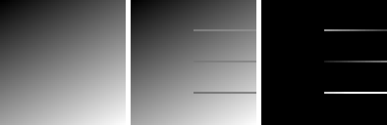

# JPEG admission and NV12 clarification

Date: 2026-11-15, Asia/Shanghai.

`admission-checks.json` records fifteen checks of the current probe. Progressive
JPEG and unqualified JPEG coding modes are rejected before video-device open.
Malformed headers, duplicate frame headers and mismatched dimensions also fail
before the driver is entered. A baseline JPEG containing an FF C2 byte sequence
inside APP metadata remains admissible. A preload guard intercepted all video
open attempts and ioctls; no physical device was used for these checks. The
same source compiled for ARM. The existing software Reader was not changed.

`native-codec-probe-benchmark-as-run.c` preserves the earlier C source for the
measured benchmark binary. The current probe adds the admission policy after
those measurements; it does not rewrite their recorded executable identity.

`nv12-luma-detail.json` analyzes the retained tail-corrected NV12 result from
`display-codec-20261115-84f68bec`. There were 96 wrong Y values in the 64-by-64
image: columns 33-64 of rows 16, 32 and 48, using one-based coordinates.
For example, row 48, column 64 should be 211 but was 133. The maximum difference
was 78 codes. The same input through GREY matched all 4096 reference pixels.
The corrected NV12 case had no timeout and no incorrect initialization
sentinels; the error was actual luma values at those locations. Its root cause
has not been established, so the result does not prove silicon-wide NV12
incompatibility or failure of USERPTR as a buffer interface.

The image below shows correct GREY, default NV12 Y, and amplified absolute
difference from left to right. It displays enlarged decoded buffers, not an
optical capture of the panel.

