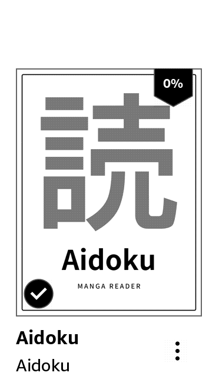

# Startup font/progress experiment and official Library logo

Date: 2026-11-16, Asia/Shanghai.

Both proposed startup changes improved their targeted work. In a four-variant
Scribe experiment, the combination reduced median software-ready time from
**5.005 s to 4.035 s** and first Library-frame submission from **5.245 s to
4.425 s**. These are improvements of 19.4% and 15.6% over the already optimized
`6660e32` baseline. The official Aidoku website logo was separately installed
as the Library cover after performance sampling.

The selected experimental code is the combined variant. It is retained on
`codex/startup-font-progress-experiment`; this experiment has not merged it into
main or replaced the daily-use application. A verified candidate ZIP includes
the combined executable and the official-logo update.

## Independent changes

**Progress-only** moves loading-animation updates into genuine preparation
waits. It keeps feedback while fonts or metadata are unavailable, but does not
queue a final progress-bar update while attaching the prepared application.
Initial-scene, cancellation, and native ownership gates remain in place.

**Fonts-only** expands the nine canonical gzip font sources at build time.
The application registers immutable, static ELF-backed bytes through Fontique's
shared blob API, without runtime gzip expansion or a full heap copy. The font
families, weights, outlines, and coverage are unchanged. The original source
gzip files, manifest hashes, and licenses remain canonical.

**Combined** applies both changes. The production launcher and native display
backend are identical across all four variants.

Implementation: [startup coordinator](../../../src/bootstrap_startup.rs),
[font registration](../../../src/bootstrap_fonts.rs),
[build expansion](../../../build.rs), and
[font provenance](../../../assets/fonts/README.md).

## Results

There was one warmup per variant and four measured rounds. Each variant occupied
each position once, using a balanced order:

1. Baseline, Progress, Combined, Fonts.
2. Progress, Fonts, Baseline, Combined.
3. Fonts, Combined, Progress, Baseline.
4. Combined, Baseline, Fonts, Progress.

All 20 launches succeeded and returned native control. Each measured cell below
contains four observations; warmups are retained but excluded from the summary.

| Variant | Software-ready median | First Library SEND median | Font gate median | View-attached to ready median |
| --- | ---: | ---: | ---: | ---: |
| Baseline (`6660e32`) | 5.005 s | 5.245 s | 619 ms | 368 ms |
| Progress-only | 4.595 s | 4.975 s | 602 ms | 11 ms |
| Fonts-only | 4.460 s | 4.705 s | 63 ms | 368 ms |
| Combined | **4.035 s** | **4.425 s** | **70 ms** | **11 ms** |

Progress-only improved the median first Library SEND by 270 ms, or 5.1%.
Fonts-only improved it by 540 ms, or 10.3%. Their combined result improved it
by 820 ms, or 15.6%. Independently computed medians and overlapping intervals
must not be added as though they were one execution timeline.

| Round | Baseline SEND | Progress SEND | Fonts SEND | Combined SEND |
| --- | ---: | ---: | ---: | ---: |
| 1 | 5.400 s | 4.890 s | 4.620 s | 4.350 s |
| 2 | 5.360 s | 5.050 s | 4.740 s | 4.430 s |
| 3 | 5.130 s | 4.900 s | 4.780 s | 4.530 s |
| 4 | 5.070 s | 5.080 s | 4.670 s | 4.420 s |

The progress-only whole-launch difference in round 4 was within one 10 ms
timestamp tick of baseline. Its targeted post-view interval still fell to
approximately 11 ms. The combined variant submitted the first Library frame
earlier in every round.

The native trace identifies a 240-by-24 progress-bar update between view
attachment and readiness in every measured baseline/font-only case. It is
absent from every progress-only/combined case. The approximately 368 ms
interval falls to 11–12 ms when that update is removed. This independently
confirms the loading-feedback hypothesis.

The font gate falls from approximately 619 ms to 63–70 ms. Metadata preparation
still runs in parallel, so removal of font work does not translate one-for-one
into whole-launch savings. All generated font payloads match the previously
published uncompressed SHA-256 values, and a pointer-identity regression checks
that prepared faces borrow the embedded payloads.

Full measurements, event lists, native refresh parameters, hashes, ranges,
memory snapshots, and warmups are in [factorial-results.json](factorial-results.json).

## Visible content and memory qualification

The first Library frame is an interactive business scene, not a declaration
that every background thumbnail has finished. The native captures show that
the continuing-book thumbnail can still be a placeholder in an earlier frame.
All 16 final Library captures match pixel for pixel after excluding the top
100 physical pixels containing clock/status observations. See
[the final Library comparison](native/final-library-comparison.json).

The experiment also retains a validation/shutdown checkpoint after cover
settling and final PNG capture. Its medians were 9.148 s for baseline, 8.993 s
for progress-only, 8.521 s for fonts-only, and 8.603 s for combined. This includes
a fixed post-ready dwell and capture/serialization work; it is not a direct
measurement of the first fully populated screen. The combination is therefore
recommended for earlier readiness and Library presentation, without claiming
that every thumbnail is fully loaded at 4.425 s.

The combined ARM executable is 53,329,616 bytes, versus 49,940,992 bytes for the
baseline: an increase of about 3.39 MB. The compressed source font total is
14,488,623 bytes; the raw total is 17,883,620 bytes. Archive compression largely
recovers this difference, so the complete candidate ZIP is about 29.96 MB.

RSS and `VmHWM` were sampled at the first content-send observation, not throughout
the process lifetime. Font-enabled variants used approximately 29 MiB less RSS
than their matching gzip-font variants at that observation, consistent with
avoiding full heap expansion and reducing touched compressed font pages. Larger
differences between progress variants also coincide with different phases of
background cover decoding and must not be presented as steady-state or final
peak-memory savings. The original snapshots remain in the measurement data.

## Controls and verification

- One Scribe, one boot, a shared isolated copy of the real six-book library,
  offline operation, and no cache eviction. These are warm process starts.
- All variants use the same Rust compiler, ARM target, Kindle feature set, and
  release-profile fingerprint. The established production overrides remain
  `CARGO_PROFILE_RELEASE_LTO=false`, `CARGO_PROFILE_RELEASE_CODEGEN_UNITS=16`,
  and six Cargo jobs.
- The native appmgr/Scriptlet route starts equivalent temporary entries. Timing
  comes from Rust-main markers and device-uptime timestamps of software-ready
  and native SEND-acceptance messages. Pipe scheduling contributes observation
  delay. There is no physical-tap or optical-panel completion measurement.
- Native input isolation, portrait calibration, lifecycle, display ownership,
  and the launcher are unchanged by this experiment. Other physical models,
  cold boot, battery, ghosting, and additional sleep/USB cycles are not qualified.

| Verification | Result |
| --- | --- |
| Startup/font binary tests | 22 passed |
| Original raw-font hashes and borrowed payloads | Passed |
| Deliberately blocked metadata preparation | Loading feedback continued after fonts completed |
| Cancellation during metadata preparation | Shutdown completed without becoming ready |
| Scribe and PW5 desktop Library captures | Pixel-identical to baseline |
| Native final Library body captures | All 16 pixel-identical, excluding clock/status strip |
| Native navigation crop | Equal across all four variants |
| KPM package/hook tests with the new logo | 16 passed |
| Final development-package checks | 182 passed |

An initial debug test exposed that separate uses of a `const` font table could
have distinct promoted addresses. The table was changed to a single `static`,
and the affected tests and ARM builds were repeated before device sampling.
Those discarded artifacts were not sampled. Package verification was updated
to require the canonical uncompressed font bytes in the ELF, while retaining
the source-gzip hash, expanded hash, size, and license checks.

All execution, rendering, tests, and verification ran through `ssh test-env`.
Builds initially used an isolated memory-backed cache because disk space was
low; the user subsequently cleared the worker. No local verification was run.
Frozen earlier baselines were not modified. Full native captures remain private;
published navigation crops use this batch's already-upright framebuffer pixels.

See [verification](verification.json), [desktop evidence](desktop/verification.json),
[native evidence](native/verification.json), and
[package checks](package-verification.json).

## Official logo

The cover now uses the actual [Aidoku website SVG](https://aidoku.app/images/aidoku.svg).
It exactly matches `static/images/aidoku.svg` at official website repository
commit `3de2b3f26b69b1d22ccb2bde88020055f5e5fa5c`. The original vector, its color,
proportions, license, and source hash are preserved. The Kindle PNG is an opaque
grayscale rendering. See [asset provenance](../../../assets/launcher/official-logo-provenance.json)
and [cover documentation](../../../assets/launcher/README.md).

The versioned `aidoku-cover-v2.png` path updates the native thumbnail reference.
The PNG, metadata entry, and notices were installed after performance sampling,
with original-entry/notice backups. The scanner registered the new path and
the native Home recent-items shelf displayed the official mark. The application,
production launcher, library database, lighting, and boot identity were preserved.
Both the experiment and logo-update batches restored owned native state and
released their exact leases.

[Logo deployment](logo/deployment.json) and [capture provenance](logo/captures.json)
retain the source-bound result without publishing unrelated native shelf content.

## Delivery

The candidate ZIP contains the exact sampled combined executable, unchanged
production launcher/JPEG worker, official-logo cover, and complete notices. It
contains no benchmark entry scripts, automatic exits, runtime data, credentials,
or private transport files. Packaging adds the separately verified logo assets;
the sampled startup source identity and final packaging identity are both retained.

- Application SHA-256:
  `81302b133f196cd0324adf0a2c06b996c503511d9be3404b4127dc45de4ab9a8`.
- ZIP SHA-256:
  `071886dd0b9d18465bd1629a457d0ac6e0708e4847a898256ca3072d7232c4ab`.

See [delivery identities](delivery.json). The new cover is installed on the
device; the startup executable remains a candidate and has not replaced the
daily-use application.
