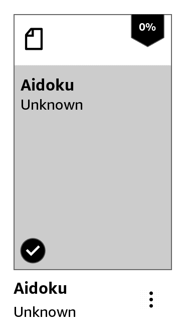
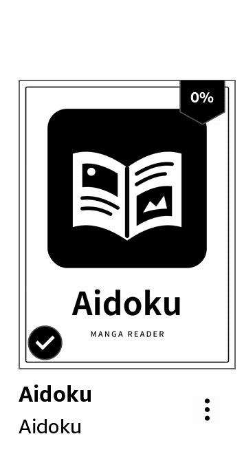

# Library startup investigation and application cover

Date: 2026-11-16, Asia/Shanghai.

Three native Scriptlet launches on the shared Scribe reached application-ready
in an estimated **5.943, 6.192, and 7.579 seconds**; the median is **6.192 seconds**.
The largest costs are the launcher handoff and the first native startup scene.
Warm metadata preparation takes about 83 ms and runs alongside approximately
499 ms of font preparation. The original monochrome application cover is now
installed, indexed, and visibly rendered on the native Home recent-items shelf.

This delivery investigates startup and implements the cover. The installed
application and production launcher are unchanged. The optimization candidates
below have not been implemented or benchmarked as improvements.

## Measurement scope

- Base checkout: `d64dd5d928e53a26147dc1dc0827d355950aba36`, plus the cover changes
  in this working tree.
- Installed application SHA-256:
  `ba3053fe764a31424f18d0f0836e5e6f616948ee0978a6f1fc8cab0b56d0757a`.
- Production launcher SHA-256:
  `2369a9ffd8c62ac43717f3528be96662055013418aeb834e9ecfea247ace3e69`.
- One boot, Scribe profile, an isolated SQLite backup of the real six-book
  library, offline operation, and no cache eviction. One direct launch prepared
  the isolated data directory before the three native launches.
- Native launches used `com.lab126.appmgrd` and the installed Scriptlet handler
  to open an equivalent temporary script outside the indexed documents folder.
  Its production launcher copy gained timing markers and bounded capture/exit
  arguments; the ARM application itself was copied byte for byte.
- Shell markers read `/proc/uptime`, with centisecond resolution. Application
  markers use the existing `--performance-trace` monotonic Rust-main clock.

The combined estimate adds the shell interval before application exec to the
application's main-to-ready interval. It excludes ELF loading before Rust main,
physical touch before the native request, final panel completion, and complete
thumbnail settling. The baseline request marker also includes a short powerd
keep-awake call. These are warm process-start measurements, not cold reboot or
network-dependent startup measurements. `startup_ready` publishes application
state; it is not proof that the final Library frame has physically completed.

All execution, rendering, packaging tests, device transport, and verification
ran through `ssh test-env`. Physical access used fresh owner/token leases for
each continuous batch. Original metadata was preserved, temporary profiling
stages were removed, native services and lighting were restored, and every
owned lease was released. Full private captures and raw logs remain on the
worker; published evidence omits credentials, device identity, and library titles.

## Where startup time goes

| Interval | Native-run median | Native-run range | Interpretation |
| --- | ---: | ---: | --- |
| Native open request to Scriptlet entry | 0.330 s | 0.290–0.340 s | Native handler dispatch, including the baseline keep-awake call |
| Scriptlet entry to application exec request | 2.230 s | 2.080–3.670 s | Launcher supervision, native observations, and display takeover |
| Rust main to startup-scene submission marker | 1.872 s | 1.817–1.966 s | Backend/window setup and the initial display/input boundary |
| Font preparation and registration | 0.499 s | 0.496–0.505 s | Nine compressed font faces, after the startup scene |
| Metadata preparation, parallel with fonts | 0.083 s | 0.080–0.084 s | Existing library, cache/controller setup, and preferences |
| Fonts registered to application-ready | 1.208 s | 1.201–1.210 s | Preferences, yielding attachment stages, and initial view publication |

The metadata row overlaps the font row. Independently computed medians should
not be added to reproduce the median of complete runs. Per-run boundaries and
the exact calculation are in [startup-measurements.json](startup-measurements.json).

Within the launcher, portrait calibration takes **1.290–2.080 s** and the
optional sleep-cover capability observation takes **0.330–0.890 s**. Pausing the
native display owners takes another **0.120–0.280 s**. The first loading-scene
marker is reached about **4.237–5.872 s** after the native request, explaining
why the initial response can feel particularly slow.

The currently installed document entry directly invokes `aidoku/launch.sh`.
It does not use KPM. The separate KPM template is still supported, but removing
KPM cannot improve the installed path measured here.

### Native observations and supervision

[`launch.sh`](../../../packaging/kindle/launch.sh) establishes the power-event
observer, queries blanket's loaded modules, performs a generation-bound portrait
calibration, pauses the window manager/status bar, and then starts the app.
Its native-reader supervisor checks child completion at 100 ms intervals.

[`portrait_writer.rs`](../../../src/native_presentation/portrait_writer.rs)
performs six sequential LIPC queries on this Scribe: active power state before
and after, display mode before and after, and portrait direction before and
after. It also checks framebuffer/sensor state and authenticates the permitted
publisher before writing the calibration record.

A separate diagnostic launch wrapped `lipc-get-prop` without changing the app.
Those six queries themselves totaled about **260 ms**, while the surrounding
portrait transaction took **1.190 s**. Blanket's query took approximately **20 ms**
inside a **230 ms** outer stage. The difference includes helper startup, sensor
inspection, private-record checks, supervision, scheduling, and collection; it
cannot all be assigned to IPC. The wrapper adds overhead, so this diagnostic is
kept separate from the baseline distribution in
[startup-query-diagnostic.json](startup-query-diagnostic.json).

The upstream Scriptlet launcher also touches the opened script and requests a
full scanner pass before forking it. This can overlap startup work. The native
runs had a slower handoff than the direct control, but that comparison alone
does not prove scanner contention caused the difference. See the pinned
[native Scriptlet handler](https://github.com/KindleModding/sh_integration/blob/adb7ef5c570a25c76fd64e94837ae0f590bd3b9c/launcher/main.c).

### Initial rendering and attachment

From event-loop entry to the startup-scene marker takes **1.355–1.390 s**.
The native backend explicitly submits an initial blank full refresh and later
submits the first actual scene through the full input-boundary path. See
[`platform.rs`](../../../vendor/slint-backend-kindle/src/platform.rs).
The trace does not divide this interval into rendering versus individual kernel
waits, so it is not a measurement of one waveform's optical duration.

[`bootstrap_startup.rs`](../../../src/bootstrap_startup.rs) starts font and
metadata workers only after the initial scene has been submitted and an event
loop turn has yielded. It then waits for every font face before attaching the
application. [`startup.rs`](../../../src/app/startup.rs) yields between route,
catalog, view, settings, cover, and ready stages. These gaps include rendering
and event-loop work; marker-to-marker durations are not pure function CPU time.
The initial view also obtains native status and publishes its Library models.

The older approximately nine-second demo traces include synthetic catalog
seeding. They are not used to characterize this user's ordinary Library startup.
The first direct launch into the fresh isolated directory spent 621 ms preparing
metadata; the subsequent native samples spent only 80–84 ms there.

## Optimization priorities

| Priority | Candidate | Why it is promising | Required preservation and qualification |
| --- | --- | --- | --- |
| 1 | Merge the initial blank refresh with the first meaningful startup scene | The first display/input boundary occupies about 1.36 s and the source submits both a blank refresh and a scene | Keep native ownership, portrait consistency, full-frame input isolation, and wake/USB behavior; measure actual driver waits and panel behavior |
| 1 | Reduce native-reader process and polling overhead | Pre-exec handoff occupies 2.08–3.67 s; the diagnostic shows substantial time outside the queried services | Retain fresh generation/nonces, before/after observations, deadlines, ownership checks, and exact restoration; consider completion-driven waiting and shared native-query setup |
| 2 | Coalesce cheap attachment stages and redundant loading-stage redraws | Approximately 1.2 s remains after fonts are registered, despite metadata already being ready | Bound work per event-loop turn, retain cancel/error responsiveness, and compare the first useful Library frame |
| 2 | Overlap non-UI preparation with initial display work | About 0.5 s of font work currently begins after the first scene boundary | Start only after safe backend/environment initialization; measure CPU contention and preserve prompt loading feedback |
| 3 | Load only immediately needed font weights, then the rest | All nine faces are currently required before attachment | Avoid missing glyphs, font swaps, or typography changes; measured opportunity is bounded by the roughly 0.5 s font stage |

No numerical speedup is claimed for these candidates. A useful next experiment
would retain the same library snapshot and entry route, record first meaningful
frame submission/completion separately, and compare alternating baseline and
candidate runs on the Scribe before checking Paperwhite hardware.

## Cover implementation and verification

The previous document entry had no `# Icon:` field. Kindle therefore displayed
its generic document card. Scriptlet integration supports an absolute image path
or an inline image in this header; its parser reads the first six lines. See the
[Scriptlet metadata documentation](https://kindlemodding.org/kindle-dev/scriptlets.html)
and the pinned [header parser](https://github.com/KindleModding/sh_integration/blob/adb7ef5c570a25c76fd64e94837ae0f590bd3b9c/utils/utils.c).

- [PNG cover](../../../assets/launcher/aidoku-cover.png): 600 × 800, opaque 8-bit
  grayscale, 22,063 bytes. Large black/white shapes keep the open manga book and
  Aidoku name recognizable in small native thumbnails.
- [Editable SVG](../../../assets/launcher/aidoku-cover.svg) and
  [generator](../../../scripts/generate-launcher-cover.py): original vector
  artwork with bundled Noto glyphs converted to paths. No runtime fonts or
  external image references are needed.
- Both document-entry templates declare
  `# Icon: /mnt/us/aidoku/assets/aidoku-cover.png` within their first six lines.
  The existing `DontUseFBInk` declaration remains in place.
- Both package paths include the PNG and its provenance notice. The KPM
  installation allowlist copies the image before the document entry.
- On the device, the PNG, artwork notice, and entry metadata were installed with
  an original-entry backup. A scanner refresh registered the cover path in the
  native catalog. No direct catalog database write or replacement global hook
  was used.
- The application binary, production launcher, user library database, lighting,
  and boot identity matched their pre-install values. Native services remained
  active, the temporary staging directory was removed, and the lease was released.

The same-coordinate native card crops below show the actual change. They are
framebuffer captures from the Home recent-items shelf, which consumes the
Library catalog, rather than optical photographs or fabricated mockups. Full
uncropped images are preserved privately. No existing UI baseline was modified.

| Before | After |
| --- | --- |
|  |  |

Verification on `test-env` passed all **16 existing KPM package/hook tests**,
including the added assertions that the header points to the packaged PNG and
that it has the expected dimensions. Remote checks also confirmed shell syntax,
PNG decoding/mode/range, outlined SVG text, and the absence of external resources.
No application rebuild was required for this cover-only runtime change.

Evidence: [cover checks](cover-checks.json), [test output](package-tests.txt),
[deployment/restoration](cover-deployment.json), and
[native capture provenance](native/captures.json).
