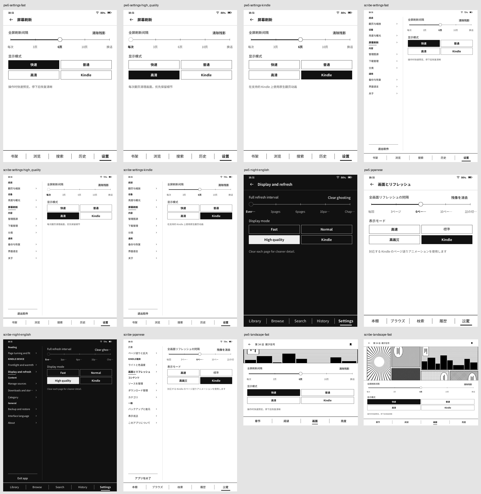

# Display-preset candidate captures

Captured on 2026-11-15 through `ssh test-env`.

These are supplemental captures for the uncommitted display-preset candidate
based on `a53b9716d64fe5521fac38431b24732c75cb8ff7`. They do not replace the
frozen 2026-11-14 baseline. R05 (Image options) and S04 (Screen refresh) are
covered; R04 (Reading options) was consulted as the adjacent baseline.

The final pointer/state suite passed 24 cases across Paperwhite 5 and Scribe:
four presets in settings and the reader panel, cold persistence, landscape
Fast, English night mode and Japanese. The original PNGs, state sidecars,
geometry metadata and action replays are retained without alteration.
The contact sheet is a derived preview. New controls and their descriptions
were visually inspected in both profiles; full-size High Quality screenshots
were also inspected. No physical panel behavior is inferred from desktop PNGs.

The captured executable SHA-256 is
`030821e2c91c36f0f0b22befa62146a4907be16cc9b588fcd8e9efee9d1c8f3f`.
The final source snapshot contains 324 files with fingerprint
`6aa0238178d4a7504e8b55f9b5a1df66174fa734622302aef2fdea2000f655c8`.
Compiled inputs were unchanged after capture; the final source manifest also
includes subsequent non-runtime documentation updates. A source fingerprint
is not a new Git commit.

- [Contact sheet](contact-sheet.png)
- [Capture manifest](manifest.json)
- [Pointer/state report](report.json)
- [Source manifest](source-manifest.json)
- [File checksums](SHA256SUMS)

| Scene | Paperwhite 5 | Scribe |
| --- | --- | --- |
| S04 Fast | [PNG](pw5-settings-fast.png) | [PNG](scribe-settings-fast.png) |
| S04 Normal | [PNG](pw5-settings-normal.png) | [PNG](scribe-settings-normal.png) |
| S04 High Quality | [PNG](pw5-settings-high_quality.png) | [PNG](scribe-settings-high_quality.png) |
| S04 Kindle | [PNG](pw5-settings-kindle.png) | [PNG](scribe-settings-kindle.png) |
| R05 Fast | [PNG](pw5-reader-fast.png) | [PNG](scribe-reader-fast.png) |
| R05 High Quality | [PNG](pw5-reader-high_quality.png) | [PNG](scribe-reader-high_quality.png) |
| Landscape Fast | [PNG](pw5-landscape-fast.png) | [PNG](scribe-landscape-fast.png) |
| English night | [PNG](pw5-night-english.png) | [PNG](scribe-night-english.png) |
| Japanese | [PNG](pw5-japanese.png) | [PNG](scribe-japanese.png) |

