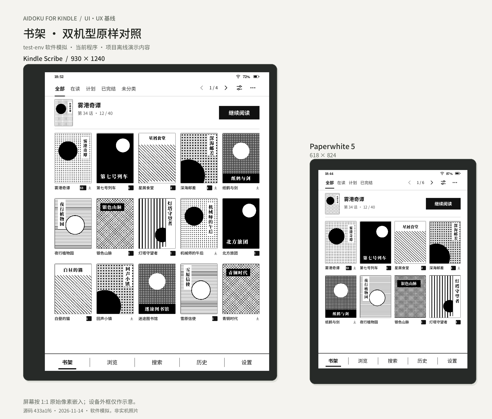

# UI/UX baselines

Frozen captures provide a shared visual reference for future interface changes.
Use a scene ID and device profile when describing an iteration, for example
`R04 / pw5` for the Paperwhite reading-options panel.

## Current baseline

| Baseline | Application source | Profiles | Captures |
| --- | --- | --- | --- |
| [2026-11-14](2026-11-14-433a1f6/README.md) | `433a1f6ba6478bc82abe21163aeff345d4acd621` | `scribe`, `pw5` | 31 paired states, 62 original PNGs |

- [Interactive comparison](2026-11-14-433a1f6/index.html): open the local file in
  a browser; select a scene, compare layouts, hide the illustrative frames or
  inspect an original screenshot at 100%.
- [Paired device overview](2026-11-14-433a1f6/overview.png).
- [Scribe contact sheet](2026-11-14-433a1f6/contact-sheets/scribe.png) and
  [Paperwhite 5 contact sheet](2026-11-14-433a1f6/contact-sheets/pw5.png).
- [Scene and image manifest](2026-11-14-433a1f6/manifest.json),
  [capture verification](2026-11-14-433a1f6/evidence/verification.json),
  [viewer verification](2026-11-14-433a1f6/evidence/viewer-checks.json) and
  [file checksums](2026-11-14-433a1f6/SHA256SUMS).



All screenshots come from the actual application running on `test-env` with
the built-in offline demo fixture. Portrait captures are 930 x 1240 for Scribe
and 618 x 824 for Paperwhite 5; landscape swaps those axes. The desktop renderer
uses a scale factor of one. Device frames are illustrative. Physical e-ink
refresh, ghosting, illumination and touch hardware are outside this record.

The dated directory preserves the original delivered files byte for byte,
including capture state, geometry, action replays, evidence and historical
helper scripts. Absolute worker paths in sidecars describe the original run;
the viewer and image links resolve within the baseline directory.

## Scene index

| ID | Scene | Scribe | Paperwhite 5 |
| --- | --- | --- | --- |
| L01 | Library | [PNG](2026-11-14-433a1f6/raw/scribe/library.png) | [PNG](2026-11-14-433a1f6/raw/pw5/library.png) |
| L02 | Library, second page | [PNG](2026-11-14-433a1f6/raw/scribe/library-page-two.png) | [PNG](2026-11-14-433a1f6/raw/pw5/library-page-two.png) |
| L03 | Library sorting and filters | [PNG](2026-11-14-433a1f6/raw/scribe/library-sort.png) | [PNG](2026-11-14-433a1f6/raw/pw5/library-sort.png) |
| L04 | Library selection | [PNG](2026-11-14-433a1f6/raw/scribe/library-selection.png) | [PNG](2026-11-14-433a1f6/raw/pw5/library-selection.png) |
| B01 | Browse entry | [PNG](2026-11-14-433a1f6/raw/scribe/browse-entry.png) | [PNG](2026-11-14-433a1f6/raw/pw5/browse-entry.png) |
| B02 | Source catalog | [PNG](2026-11-14-433a1f6/raw/scribe/catalog.png) | [PNG](2026-11-14-433a1f6/raw/pw5/catalog.png) |
| B03 | Source management | [PNG](2026-11-14-433a1f6/raw/scribe/sources.png) | [PNG](2026-11-14-433a1f6/raw/pw5/sources.png) |
| B04 | Search results | [PNG](2026-11-14-433a1f6/raw/scribe/search.png) | [PNG](2026-11-14-433a1f6/raw/pw5/search.png) |
| B05 | Search keyboard | [PNG](2026-11-14-433a1f6/raw/scribe/search-keyboard.png) | [PNG](2026-11-14-433a1f6/raw/pw5/search-keyboard.png) |
| B06 | Reading history | [PNG](2026-11-14-433a1f6/raw/scribe/history.png) | [PNG](2026-11-14-433a1f6/raw/pw5/history.png) |
| D01 | Book details and chapters | [PNG](2026-11-14-433a1f6/raw/scribe/detail.png) | [PNG](2026-11-14-433a1f6/raw/pw5/detail.png) |
| D02 | Chapter selection | [PNG](2026-11-14-433a1f6/raw/scribe/detail-selection.png) | [PNG](2026-11-14-433a1f6/raw/pw5/detail-selection.png) |
| D03 | Bookmarks | [PNG](2026-11-14-433a1f6/raw/scribe/detail-bookmarks.png) | [PNG](2026-11-14-433a1f6/raw/pw5/detail-bookmarks.png) |
| R01 | Fullscreen reader | [PNG](2026-11-14-433a1f6/raw/scribe/reader-fullscreen.png) | [PNG](2026-11-14-433a1f6/raw/pw5/reader-fullscreen.png) |
| R02 | Reader controls | [PNG](2026-11-14-433a1f6/raw/scribe/reader-controls.png) | [PNG](2026-11-14-433a1f6/raw/pw5/reader-controls.png) |
| R03 | Reader after a page turn | [PNG](2026-11-14-433a1f6/raw/scribe/reader-next-page.png) | [PNG](2026-11-14-433a1f6/raw/pw5/reader-next-page.png) |
| R04 | Reading options | [PNG](2026-11-14-433a1f6/raw/scribe/reader-mode.png) | [PNG](2026-11-14-433a1f6/raw/pw5/reader-mode.png) |
| R05 | Image options | [PNG](2026-11-14-433a1f6/raw/scribe/reader-picture.png) | [PNG](2026-11-14-433a1f6/raw/pw5/reader-picture.png) |
| R06 | Reader brightness | [PNG](2026-11-14-433a1f6/raw/scribe/reader-brightness.png) | [PNG](2026-11-14-433a1f6/raw/pw5/reader-brightness.png) |
| R07 | Reader to chapters | [PNG](2026-11-14-433a1f6/raw/scribe/reader-chapters.png) | [PNG](2026-11-14-433a1f6/raw/pw5/reader-chapters.png) |
| S01 | Settings entry | [PNG](2026-11-14-433a1f6/raw/scribe/settings.png) | [PNG](2026-11-14-433a1f6/raw/pw5/settings.png) |
| S02 | Page turns and scaling | [PNG](2026-11-14-433a1f6/raw/scribe/settings-default-direction.png) | [PNG](2026-11-14-433a1f6/raw/pw5/settings-default-direction.png) |
| S03 | Brightness and warmth | [PNG](2026-11-14-433a1f6/raw/scribe/settings-frontlight-warmth.png) | [PNG](2026-11-14-433a1f6/raw/pw5/settings-frontlight-warmth.png) |
| S04 | Screen refresh | [PNG](2026-11-14-433a1f6/raw/scribe/settings-screen-refresh.png) | [PNG](2026-11-14-433a1f6/raw/pw5/settings-screen-refresh.png) |
| S05 | Download management | [PNG](2026-11-14-433a1f6/raw/scribe/settings-storage.png) | [PNG](2026-11-14-433a1f6/raw/pw5/settings-storage.png) |
| S06 | Download queue | [PNG](2026-11-14-433a1f6/raw/scribe/downloads.png) | [PNG](2026-11-14-433a1f6/raw/pw5/downloads.png) |
| S07 | About | [PNG](2026-11-14-433a1f6/raw/scribe/settings-about.png) | [PNG](2026-11-14-433a1f6/raw/pw5/settings-about.png) |
| N01 | Night library | [PNG](2026-11-14-433a1f6/raw/scribe/library-night.png) | [PNG](2026-11-14-433a1f6/raw/pw5/library-night.png) |
| N02 | Night reader controls | [PNG](2026-11-14-433a1f6/raw/scribe/reader-controls-night.png) | [PNG](2026-11-14-433a1f6/raw/pw5/reader-controls-night.png) |
| W01 | Landscape reader | [PNG](2026-11-14-433a1f6/raw/scribe/reader-landscape.png) | [PNG](2026-11-14-433a1f6/raw/pw5/reader-landscape.png) |
| W02 | Landscape reader controls | [PNG](2026-11-14-433a1f6/raw/scribe/reader-landscape-controls.png) | [PNG](2026-11-14-433a1f6/raw/pw5/reader-landscape-controls.png) |

## Use during iteration

1. Inspect the same scene on both profiles. Use the raw PNG and its adjacent
   `.state.json` and `.metadata.json` files to distinguish visual output from
   application state. The viewer can display each PNG at its original size.
2. Make changes against the identified scene and preserve the frozen directory.
   Copy capture helpers into the new run's workspace before adjusting pointer
   coordinates or expected states for a changed interface.
3. Build and capture the candidate through `ssh test-env`. Use fresh data and
   output directories. The stored capture helper accepts `--binary`,
   `--output-dir` and an optional `--only` list of scene identifiers.
4. Record the new application commit, binary hash, PNG hashes and actual remote
   results. Store a later adopted baseline under a new
   `YYYY-MM-DD-<source-commit>` directory, then update this index.

Example capture command from PowerShell, after preparing the matching executable
and checkout on the remote worker:

```powershell
$AidokuRemoteCheckout = '/path/to/remote/checkout'
$AidokuRemoteBinary = '/path/to/matching/aidoku'
$AidokuRemoteOutput = '/path/to/new/capture-output'
$AidokuCaptureHelper = "$AidokuRemoteCheckout/docs/uiux-baselines/2026-11-14-433a1f6/tools/capture-baseline.py"
ssh test-env "python3 '$AidokuCaptureHelper' --binary '$AidokuRemoteBinary' --output-dir '$AidokuRemoteOutput'"
```

The other archived helpers retain the original worker layout used to compose
the boards and inspect the viewer. Their paths are historical execution context.
Cargo build concurrency remains six. The repository's remote-verification rules
also apply to future captures and file integrity checks.

To verify the frozen files on the worker:

```powershell
$AidokuRemoteBaseline = '/path/to/remote/checkout/docs/uiux-baselines/2026-11-14-433a1f6'
ssh test-env "cd '$AidokuRemoteBaseline' && sha256sum --check --quiet SHA256SUMS"
```
